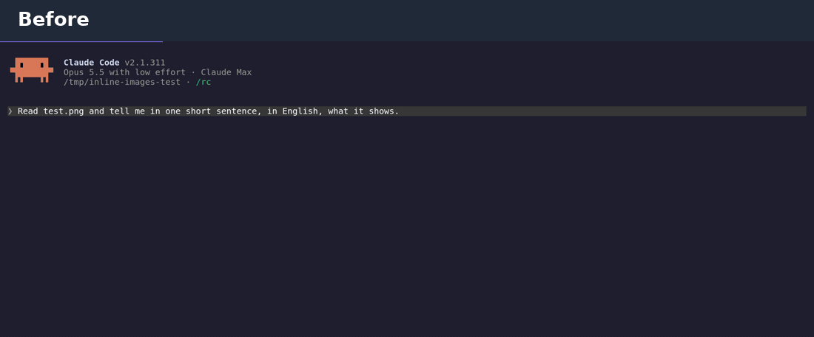

# inline-images

A Claude Code mod that draws PNG images right in your terminal, instead of a one-line `[image] file.png` reference.

- **Images Claude reads** (the `Read` tool on a `.png`) show up small under the "Read N files" line, in any session.
- **Images Claude sends you** (the `SendUserFile` tool, in Remote Control sessions) show up large, with the caption above.

Each image has its path below it as a link: click it to open the file in your system image viewer.



## Install

At the prompt of a Claude Code terminal session:

```
/plugin install inline-images --marketplace kbrianps/claude-inline-images
```

Answer `y` to add the marketplace, then pick a scope (user scope loads it in every session).

From a shell:

```
claude plugin install inline-images --marketplace kbrianps/claude-inline-images
```

Requires Claude Code 2.1.287 or newer (mods support).

## Terminals

| Terminal | Result |
| --- | --- |
| Ghostty | image |
| kitty | image |
| tmux with passthrough (see below) | image |
| iTerm2 3.5+ in fullscreen rendering | image, per the Claude Code docs (not tested yet) |
| tmux without passthrough, GNU screen | `[image] name.png` and the clickable path |
| GNOME Terminal, Ptyxis, VS Code terminal | `[image] name.png` and the clickable path |

The picture uses the kitty graphics protocol. Where the terminal can't draw it, you get the file name and the path, never a broken box.

### tmux

Add to `~/.tmux.conf` and restart tmux:

```
set -g allow-passthrough on
set -g focus-events on
```

## What it does not do

- Only PNG. JPEG, WebP and GIF keep Claude Code's default line, because the terminal image element takes PNG or raw pixels only.
- PNGs over 2 MiB are drawn from the file path, which needs the terminal to read the file itself: it works in local Ghostty and kitty, not over SSH or inside tmux.
- When a group of reads is expanded (ctrl+o), Claude Code's own rows are shown.
- Desktop app, VS Code extension and mobile are left untouched.
- `SendUserFile` exists only in Remote Control sessions (`claude --remote-control` or `/rc`); reads work everywhere.

## Development

```
claude plugin validate .
claude plugin test .
```

The plugin API this mod uses is early access in Claude Code and may change between releases. Tested with Claude Code 2.1.311.

## License

MIT
